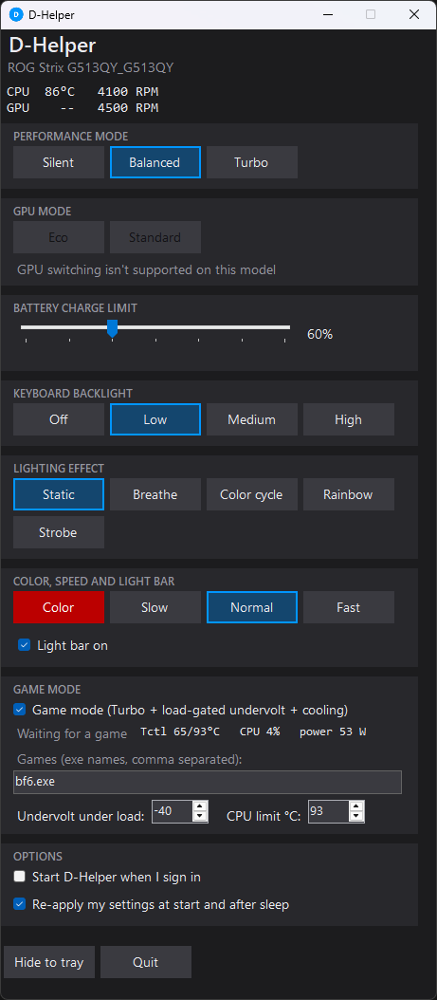

# D-Helper

A small tray app for ASUS ROG / TUF laptops, built from the hardware protocol recovered from G-Helper 0.291 with REA
(static reverse engineering). Developed and tested on a **ROG Strix G513QY** (Ryzen 9 5980HX).



## What it does

| Feature | How | Works on G513QY |
|---|---|---|
| Performance mode (Silent / Balanced / Turbo) | ATKACPI device `0x00120075` | Yes |
| Battery charge limit (40–100 %) | ATKACPI device `0x00120057` | Yes |
| Keyboard backlight (Off / Low / Medium / High) | USB HID feature report `5A BA C5 C4 <level>` (ACPI `0x00050021` fallback) | Yes (HID, PID 0x1866) |
| Lighting effect (Static / Breathe / Color cycle / Rainbow / Strobe), colour, speed | USB HID output report `5D B3 …` + `5D B5` + `5D B4` | Yes |
| Light bar on/off while awake | USB HID `5D BD 01 <kb> <bar> <lid> <rear> FF` | Yes |
| CPU / GPU temperature, fan RPM | ATKACPI `0x00120094`, `0x00120097`, `0x00110013`, `0x00110014` | CPU temp + both fans; no GPU temperature on this model |
| GPU Eco / Standard | ATKACPI `0x00090020` (+ MUX `0x00090016`) | Not supported by this model's firmware, so the section is disabled |
| Game mode: undervolt, CPU temperature limit, fan boost, telemetry | Ryzen SMU through the PawnIO driver + ATKACPI fan curves | Yes (Cezanne CPUs only) |
| Tray menu, start at sign-in, re-apply after sleep | `NotifyIcon`, Task Scheduler logon task, `SystemEvents.PowerModeChanged` | Yes |

Settings, a log and per-game CSV sessions are kept in `%APPDATA%\D-Helper\`.

## Game mode

When a listed game (default `bf6.exe`) runs, D-Helper:

1. Switches to **Turbo** and sets the CPU temperature limit (default 93 °C).
2. Applies the **game undervolt** (Curve Optimizer all-core, default −40) **only after 5 s of ≥ 40 % CPU load**,
   and removes it **within about 2 s** when load drops below 25 % (menus, loading screens, alt-tab), or when the game closes.
   At the desktop the safe offset (0) is always in effect, because a deep offset that is stable under load can crash at idle.
3. **Ramps the fans first:** an aggressive fan curve kicks in 3 °C below the limit and turns off after 60 s well below it.
4. **Crash guard:** if Windows goes down while the undervolt is on, or CPU hardware errors (WHEA) are logged,
   the game undervolt is made 5 less aggressive automatically.
5. Logs a CSV of temperature, power, load, undervolt state and fan speed for each session.

Undervolt and temperature-limit settings live in the CPU and reset at every reboot.
The SMU code only writes on AMD Cezanne (Ryzen 5000 mobile) CPUs; on anything else Game mode shows as unavailable.

## Requirements

* Windows 10/11 x64 and the [.NET 10 Desktop Runtime](https://dotnet.microsoft.com/download/dotnet/10.0)
* ASUS System Control Interface driver (provides `\\.\ATKACPI`; present if Armoury Crate or G-Helper works)
* [PawnIO](https://pawnio.eu/) driver for Game mode (G-Helper installs it). D-Helper runs as administrator because of it.

**Quit G-Helper and Armoury Crate before using D-Helper.** They write the same firmware settings and will override D-Helper's.

On the very first start, D-Helper only reads sensors and changes nothing. It applies a setting when you click it,
and from then on it re-applies your choices at start and after sleep (configurable under Options).

## Build

```powershell
git clone https://github.com/dlundh/D-Helper.git
cd D-Helper\src
dotnet publish -c Release -o ..\app -p:PublishSingleFile=true -p:DebugType=none
..\app\DHelper.exe
```

The build output in `app\` is `DHelper.exe` plus `RyzenSMU.bin`, which must stay next to the exe.

## Layout

```
src/
  AsusAcpi.cs        ATKACPI DeviceIoControl wrapper (modes, battery, sensors, fan curves)
  AsusHid.cs         USB HID: keyboard backlight, Aura lighting and light bar (SetupAPI + hid.dll)
  RyzenSmu.cs        Ryzen SMU via PawnIO: undervolt, Tctl limit, power limits, PM-table telemetry
  GameController.cs  game detection, load-gated undervolt, fan boost, crash guard, CSV logging
  MainForm.cs        window + tray UI
  AppConfig.cs       settings, start at sign-in (Task Scheduler), log
  RyzenSMU.bin       signed PawnIO RyzenSMU module (third-party, see below)
docs/
  PROTOCOL.md        everything recovered from G-Helper, with REA evidence IDs and hardware test results
```

## Disclaimer

Undervolting and changing temperature limits can make a system unstable. Use at your own risk; this project is not
affiliated with ASUS, AMD or the G-Helper project.

## License and credits

D-Helper is licensed under the **GNU GPL v3.0** (see [LICENSE](LICENSE)).

* The hardware protocol was learned by statically analysing [G-Helper](https://github.com/seerge/g-helper)
  by seerge (GPL-3.0). D-Helper is a separate, much smaller implementation written from those findings.
* `src/RyzenSMU.bin` is the RyzenSMU module of the [PawnIO](https://pawnio.eu/) project
  ([PawnIO.Modules](https://github.com/namazso/PawnIO.Modules)), redistributed unmodified as bundled in G-Helper 0.291.
  It remains under its own license.
